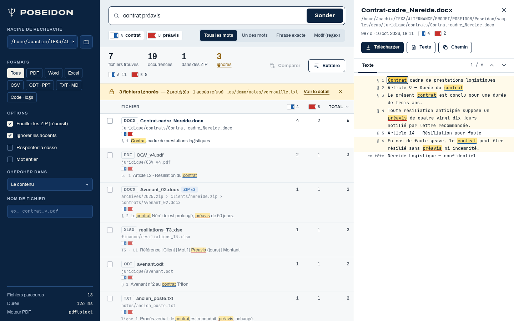

# Interface web

L'interface de Poseidon : un seul écran de travail, en HTML/CSS/JavaScript natifs, sans CDN ni étape de compilation. Le système visuel complet (jetons, règles) est dans [DESIGN.md](../../DESIGN.md).

## Sommaire

1. [Fichiers](#1-fichiers)
2. [Structure de l'écran](#2-structure-de-lécran)
3. [Univers « Pavillons de signaux »](#3-univers-pavillons-de-signaux)
4. [Zones et comportements](#4-zones-et-comportements)
5. [États](#5-états)
6. [Responsive](#6-responsive)
7. [Accessibilité et clavier](#7-accessibilité-et-clavier)
8. [Conventions de code](#8-conventions-de-code)

## 1. Fichiers

| Fichier | Rôle |
| --- | --- |
| `public/app.html` | Structure, sprite d'icônes SVG (dessinées, trait 1,7) |
| `public/assets/css/app.css` | Jetons (`:root`), mise en page, composants, responsive |
| `public/assets/js/app.js` | État, appels API, rendu, interactions |
| `public/assets/js/flags.js` | Les 12 pavillons (motif SVG + couleur-clé) |
| `public/assets/fonts/` | Archivo et JetBrains Mono (woff2, OFL) |
| `public/assets/img/trident.svg` | Icône de l'application |

## 2. Structure de l'écran



```
┌──────────────┬───────────────────────────────────────┬──────────────────────┐
│ RAIL abyssal │ Filtre : [mots…………] [Sonder]          │ VOLET                │
│ Racine  [📁] │ pavillons hissés · modes ET/OU/…      │ Aperçu | Extraction  │
│ Formats      ├───────────────────────────────────────┤ | Fichiers ignorés    │
│ Options      │ 7 fichiers · 19 occ. · 1 ZIP · 3 ign. │                      │
│ Chercher dans│ ⚠ alerte fichiers ignorés (en ligne)   │ chemin, actions      │
│ Nom fichier  │ Tableau des résultats (triable)       │ Texte | Tableau      │
│ Statistiques │ … ou vue Comparaison                  │ lignes surlignées    │
└──────────────┴───────────────────────────────────────┴──────────────────────┘
   280 px                      fluide                          448 px
```

## 3. Univers « Pavillons de signaux »

Chaque terme du filtre reçoit un pavillon du code international des signaux (ordre : A, B, I, L, C, D, E, F, G, H, J, K) et sa lettre. Ce pavillon suit le terme partout :

| Endroit | Forme |
| --- | --- |
| Sous le filtre | « pavillon hissé » : pavillon + lettre + terme |
| Synthèse | total d'occurrences par pavillon |
| En-têtes du tableau | une colonne de compteurs par pavillon |
| Chaque résultat | mini-drisse : pavillons du fichier, éteints si le terme est absent (avec compteurs sur mobile) |
| Aperçu et preuves | surlignage jaune souligné de la couleur-clé du pavillon |

Règles clés : le jaune de surlignage est réservé aux correspondances ; le sol est froid (embrun) ; un seul aplat sombre (le rail). Détails : [DESIGN.md](../../DESIGN.md).

## 4. Zones et comportements

### Rail (paramètres)

- **Racine** : saisie libre (Windows, UNC, Linux, `file://`) ; bouton dossier = navigateur de dossiers (`/api/browse`) ; 4 racines récentes mémorisées (`localStorage`).
- **Formats** : puces groupées (PDF, Word, Excel, CSV, ODT·PPT, TXT·MD, Code·logs, Courriels, Images (OCR) si Tesseract est présent) → paramètre `extensions`. Les conteneurs (ZIP, 7z, tar, courriels) sont toujours ouverts : le filtre porte sur leurs entrées.
- **Options** : ZIP, accents, casse, mot entier, fautes de frappe (recherche floue), cible (contenu / nom / les deux), filtre de nom. Mémorisées localement.
- **Index** (si `pdo_sqlite` est disponible) : état de l'index de la racine (fichiers, taille, date), boutons « Indexer ce dossier » / « Mettre à jour l'index » (progression en direct) et suppression.
- **Statistiques** : fichiers parcourus, durée, fichiers non relus grâce à l'index, moteur PDF.

### Filtre

Saisie + 5 modes (segmenté) : tous les mots, un des mots, phrase exacte, motif (regex), **proximité** (champ « à moins de N mots » affiché avec ce mode). Bouton **Historique** dans le champ : recherches enregistrées (étoile) et 15 récentes (stockage local du navigateur) ; un clic rejoue la recherche. Les pavillons se hissent pendant la frappe, avec le même découpage que le serveur (`"phrase entre guillemets"` = un terme). `Entrée` lance la recherche.

### Synthèse et résultats

- Les résultats arrivent en flux ; rendu groupé par `requestAnimationFrame`, 300 lignes puis « Afficher plus ».
- Tri par nom, par compteur de chaque terme ou par total.
- Clic ou `Entrée` sur une ligne → aperçu ; flèches haut/bas pour naviguer.
- Cases à cocher : deux fichiers → **Comparer**.
- **Extraire** ouvre le volet d'extraction ; **Rapport** ouvre le rapport HTML dans un onglet ; **Lien** copie une adresse `…/#root=…&q=…` qui rejoue la recherche à l'ouverture.

### Fichiers ignorés

Bande d'alerte en ligne sous la synthèse (jamais par-dessus le contenu) : nombre, répartition (protégés, accès refusé…), dernier chemin, lien « Voir le détail » vers le volet listant chaque fichier, sa raison et son message. Compteur « ignorés » cliquable dans la synthèse.

### Volet d'aperçu

Nom, chemin absolu complet (archives comprises), taille, date, compteurs par pavillon ; actions Télécharger, Ouvrir (PDF, texte, images), Texte (.txt extrait), Chemin (copie). Onglet **Texte** : lignes avec emplacement (ligne, page, §, feuille · ligne), navigation d'occurrence. Onglet **Tableau** (tableurs/CSV) : grille par feuille ; un clic sur une lettre de colonne l'ajoute au mapping d'extraction.

### Volet d'extraction

**Modèle** (liste des modèles enregistrés : en choisir un remplit filtre, options et extraction), mode (occurrences, lignes, colonnes, liste des fichiers), colonnes et ligne d'en-tête (mode colonnes), format (CSV, XLSX, JSON, TXT, MD), source et dédoublonnage. « Créer le document » télécharge le fichier et confirme le nombre de lignes. En bas : « Enregistrer ces réglages comme modèle ».

### Comparaison

Remplace le tableau : statistiques `+n −m`, fichiers comparés, blocs `@@`, numéros de ligne des deux côtés, copie du diff unifié.

## 5. États

| État | Rendu |
| --- | --- |
| Premier lancement | Drisse A·B·I, titre « Pose une racine, hisse tes mots. », bouton échantillons, exemples de filtres |
| Recherche en cours | Barre de progression indéterminée + chemin courant + « Annuler » ; bouton « En cours… » |
| Aucun résultat | Message adapté au mode (suggère « Un des mots » en mode ET) |
| Chargement de l'aperçu | Squelette animé |
| Fichier binaire | Note « télécharge-le pour l'ouvrir » |
| Erreur | Notification (toast) rouge avec le message du serveur |
| Extraction | Notification de succès (nombre de lignes) ou d'extraction vide |
| Authentification | Écran de connexion abyssal |

## 6. Responsive

| Largeur | Disposition |
| --- | --- |
| > 1360 px | 280 / fluide / 448 |
| 1081–1360 px | 256 / fluide / 400 |
| ≤ 1080 px | Barre supérieure abyssale ; rail en tiroir (menu) ; volet en panneau coulissant |
| ≤ 720 px | Colonnes de compteurs masquées (mini-drisse avec compteurs à la place), modes en grille 2×2, actions pleine largeur |

Captures : [bureau](../assets/interface-bureau.png) · [mobile](../assets/interface-mobile.png) · [tableur](../assets/interface-tableur.png) · [comparaison](../assets/interface-comparaison.png).

## 7. Accessibilité et clavier

- Contrastes AA vérifiés (détecteur impeccable + revue) ; aucune information portée par la seule couleur (motif + lettre de pavillon).
- `Ctrl+K` : focus sur le filtre ; `N` / `Maj+N` : occurrence suivante / précédente ; `Échap` : fermer le navigateur de dossiers, le tiroir, ou annuler la recherche.
- Rôles ARIA : `search`, `radiogroup`, `tablist`, `aria-sort`, `aria-selected`, `aria-live` sur la synthèse, `role="alert"` sur la bande d'alerte.
- `prefers-reduced-motion` respecté.

## 8. Conventions de code

- JavaScript natif en modules ES ; une fonction `h()` crée les éléments, **jamais** de `innerHTML` avec des données (protection XSS) ; seuls les motifs SVG constants des pavillons utilisent `innerHTML`.
- Aucune balise `style` ni attribut `style` (CSP `style-src 'self'`) : les valeurs dynamiques passent par `element.style.setProperty`.
- Jetons de couleur dans `:root` ; pas de couleur en dur hors palette sans raison.
- Tout appel `POST` passe par `api()` qui ajoute l'en-tête `X-Poseidon: 1`.
